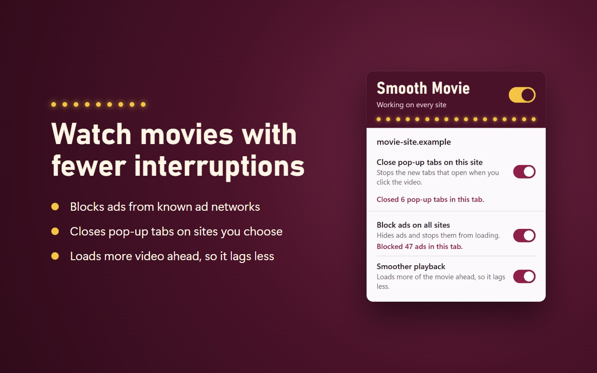
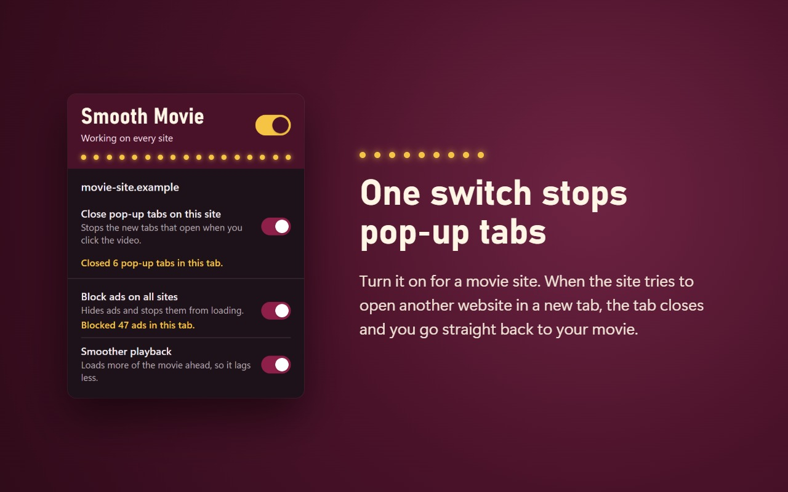

# Smooth Movie

<p align="center">
  
</p>

A Chrome extension for watching online video with fewer ads, pop-ups and pauses.

<<<<<<< HEAD
[](https://chromewebstore.google.com/detail/amcimdojlpcdohmlcffnnhffdadjlmfl)
[](https://chromewebstore.google.com/detail/amcimdojlpcdohmlcffnnhffdadjlmfl)
[](https://chromewebstore.google.com/detail/amcimdojlpcdohmlcffnnhffdadjlmfl)
=======
> **Chrome Web Store:** submitted and **waiting for Google's approval**. Until it is live, install it by hand (see [Install](#install) below).


>>>>>>> 23c88b2cc88acf4cf5b0f47fd0756074953cfaed

- **Blocks ads** on every site, using a built-in list of known ad networks.
- **Closes pop-up tabs** on sites you choose. When a page tries to open another website in a new tab, the tab is closed and you are taken back to your video.
- **Smoother playback.** Asks common web video players (hls.js and video.js) to load about 2 minutes ahead instead of 30 seconds, pick a slightly safer quality, and skip small gaps where the video gets stuck.

The toolbar menu has on/off switches and shows how many ads and pop-up tabs were blocked in the current tab.



## Install

<<<<<<< HEAD
Install it from the [Chrome Web Store](https://chromewebstore.google.com/detail/amcimdojlpcdohmlcffnnhffdadjlmfl): click **Add to Chrome**, then pin **Smooth Movie** from the puzzle-piece menu. Chrome updates it for you.
=======
### From the Chrome Web Store

Coming soon. The extension is under review by Google. The link will be added here once it is approved.

### By hand (developer mode)

1. Download this project (green **Code** button → **Download ZIP**) and unzip it.
2. In Chrome, open `chrome://extensions` and turn on **Developer mode**.
3. Click **Load unpacked** and pick the unzipped folder.
4. Pin **Smooth Movie** from the puzzle-piece menu.
>>>>>>> 23c88b2cc88acf4cf5b0f47fd0756074953cfaed

To block pop-up tabs on a site, open it, click the Smooth Movie icon and turn on **Close pop-up tabs on this site**.

## Limits

- It cannot make your internet faster. It saves more video ahead so short slowdowns don't stop playback.
- Paid services lock their own players, so the playback boost changes little there.
- On sites where pop-up closing is on, links that open *other* websites in a new tab are closed too.

## Project layout

| Path | What it is |
| --- | --- |
| `manifest.json` | Extension settings and permissions |
| `background.js` | Turns ad blocking on/off, closes pop-up tabs, keeps the counts |
| `content/player-boost.js` | Runs inside pages and video players to buffer further ahead |
| `content/settings-bridge.js` | Passes switch settings to pages and hides ad boxes |
| `rules/ads.json` | The list of blocked ad networks |
| `popup/` | The toolbar menu |
| `lib/` | Shared code (which site a page belongs to, saved settings) |
| `icons/` | Toolbar icons, drawn by `tools/make-icons.js` |
| `tests/`, `e2e/` | Quick checks and full checks in real Chrome |

## Development

Needs Node.js 22 or newer and Google Chrome.

```
npm install
npm test               # quick checks, no browser
npm run test:browser   # loads the extension in Chrome and tests it on local pages
npm run icons          # redraws the toolbar icons
npm run package        # makes dist/smooth-movie-<version>.zip for the Chrome Web Store
npm run store-images   # makes the store screenshots and promo tile in store/images/
```

Publishing steps and the text to paste into the Web Store form are in [`store/STORE-LISTING.md`](store/STORE-LISTING.md). Privacy policy: [`PRIVACY.md`](PRIVACY.md).

### Run your own copy

1. Download this project (green **Code** button → **Download ZIP**) and unzip it.
2. In Chrome, open `chrome://extensions` and turn on **Developer mode**.
3. Click **Load unpacked** and pick the unzipped folder.

After changing files, click the reload arrow on the Smooth Movie card in `chrome://extensions`. Turn off the store version while testing so the two copies don't both run.
